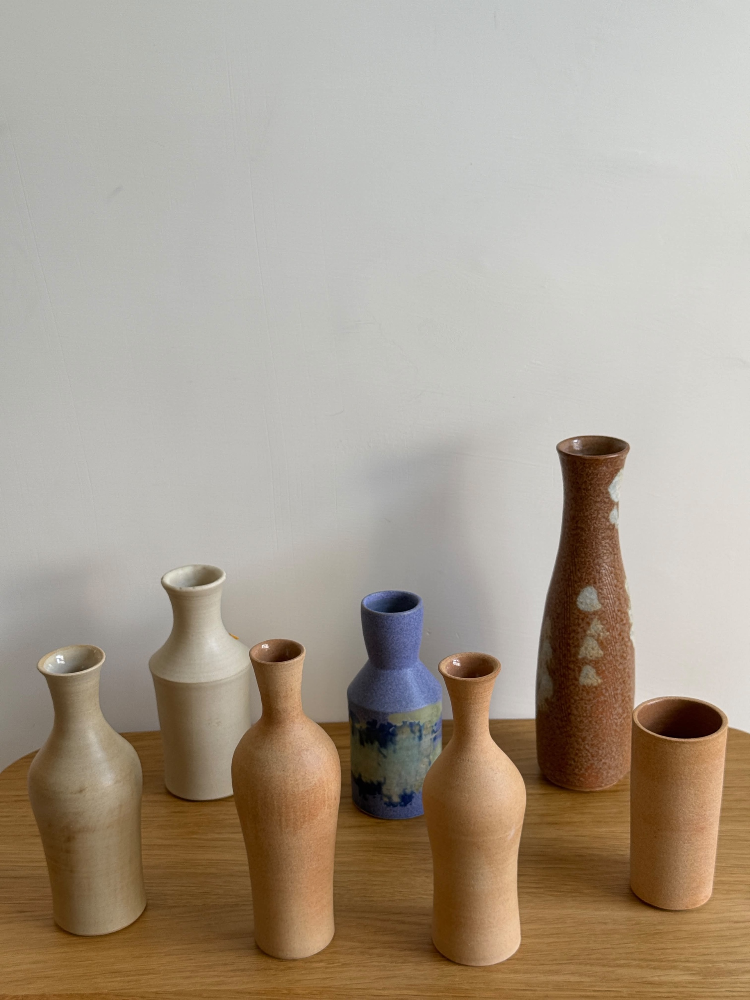
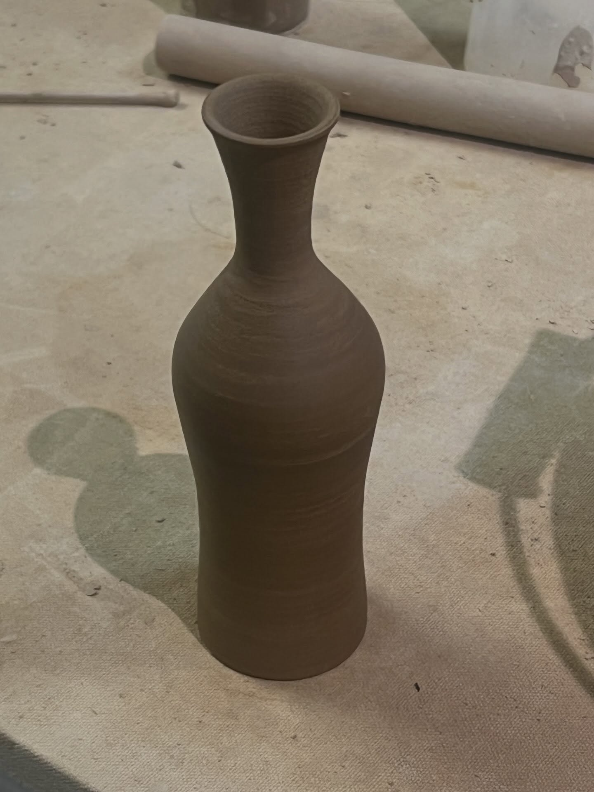
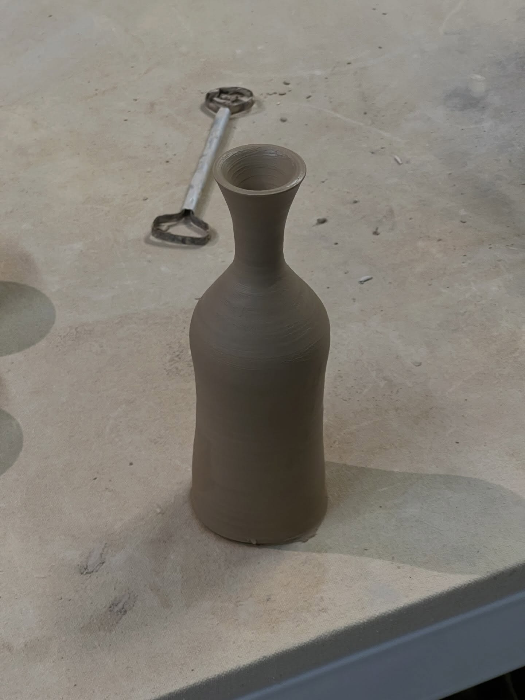

有時候會很喜歡重複做一樣的東西， 
最近是瓶子。 
嘗試了不同比例，上釉的方式， 
目前最喜歡的是無釉黃陶的版本。 
很喜歡做瓶子， 
因為他對我來說是剛剛好的難度， 
有點挑戰，但不會太難， 
可以一直做也不會覺得無聊

做這種窄身細口瓶的時候，首先遇到的難題就是底面積太窄難以支撐上方的土，拉高的時候容易歪掉，甚至土胚的牆壁像是窗簾一樣捲起😭

目前解決的方法是在拉胚的階段，下半部的土胚要留足夠厚的土牆支撐結構。

不過這也會讓後續修胚更加困難，因為在修細口瓶的時候，並無法看到內部，也就很難判斷厚度，要一直拿起來感受重量，要修出均勻的厚薄度變的很困難。不知道有沒有更好的方法呢？常常，形狀已經完成，但是牆壁還很厚，瓶子就會很重，細口瓶的比例只要差一點就會差很多，就只能止步於此。

這也就是第二個困難點，瓶子是能拉出來了，但是因為底部留了比較厚的土，整體變得很重。針對這點，解決的方式就是必須記住底部因為結構而多留的厚度大概是多厚，然後在拉胚的時候底部的比例要刻意拉的比較胖，這樣在最後修完胚的時候，就會是剛好的比例！

附圖就是同一隻瓶子拉好的時候，跟修胚完成的對比。

第三個困難則是 S 型裂痕。底部開裂可能跟底部沒有壓實還有積水有關。我習慣在最後完成的時候再用海綿吸乾底部的積水，不過在拉瓶子的時候，一旦收窄瓶口之後，就無法再看到碰到到底部，常常也就忘了底部有積水，然後在乾燥之後就會開裂。必須提醒自己，先把水吸乾再收窄瓶口，然後確保不要再讓太多水滴進去。
