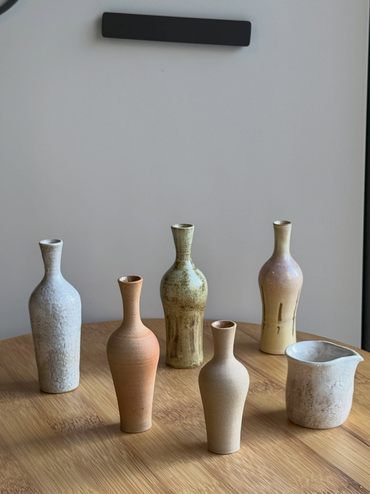
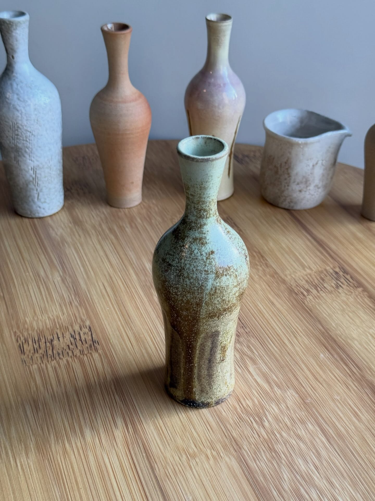
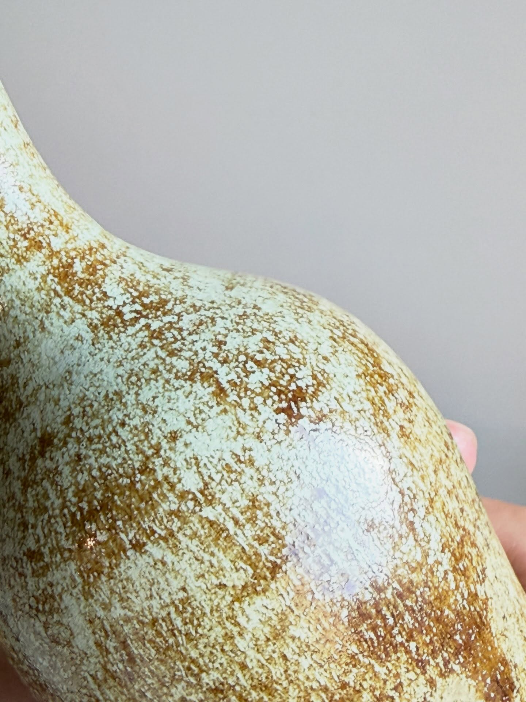
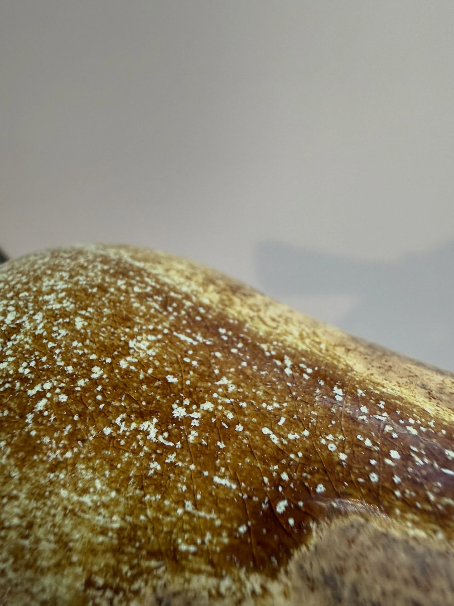
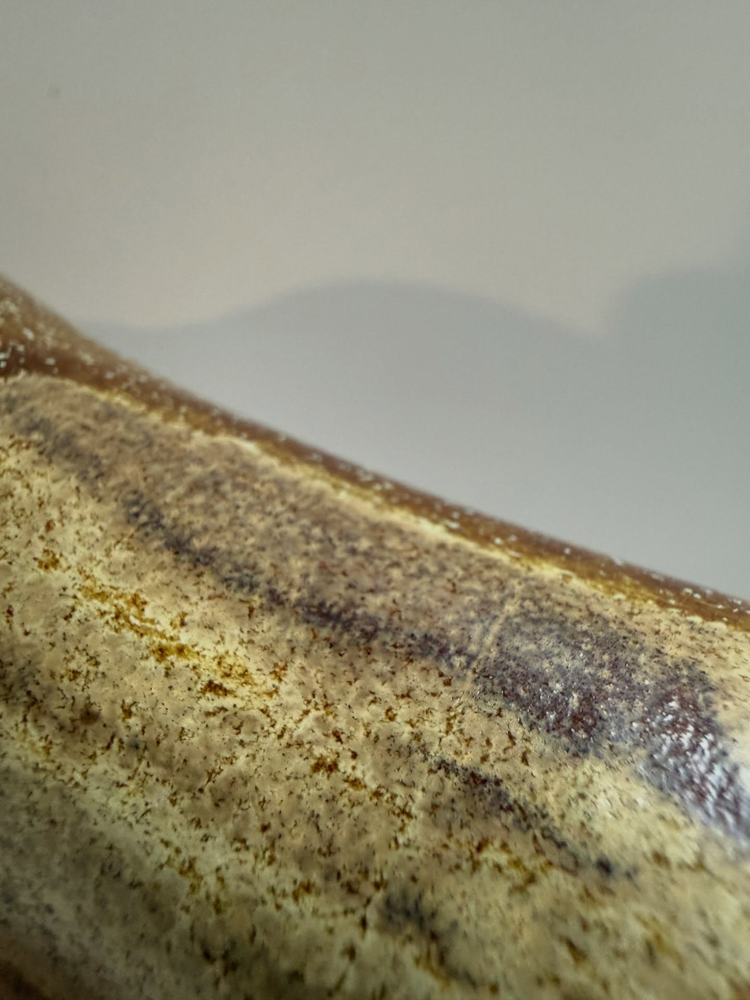

這週出窯的瓶子們。

最喜歡的是第二張照片的瓶子， 
形狀很棒，肩膀飽滿，口緣微微向外敞開， 
底座向內收窄，重量也適中。而且這支釉有好多種細節，這幾天常常忍不住拿起來就看了好久。 
上半部密集的結晶像是開滿小花，流到下方隱隱開片的琥珀河流。

前方的瓶子嘗試做了更窄高的口，收的更窄的底，讓曲線變化更大。另外一個右邊則是縮小的版本。這兩個瓶子看起來也不錯，但是更窄的底跟口會讓瓶子不穩，而且這個口緣的寬度已經比筷子還窄，幾乎沒有實用的功能，只能做擺飾。

茶海跟最左方的瓶子原本跟茶壺是一組的，在素胚上拍化妝土然後刮除一部分，燒成之後發現化妝土容易剝落，茶海因此還打磨之後重新上釉補燒了一次，茶壺也沒有朝這個方向去做了。

右後的瓶子是一個可愛的嘗試，原本修完胚還在想要不要燒，因為他歪歪的，有三個中心，後來看著覺得很像一個頭上有天線的小生物的感覺，把它留了下來，上了一個粉嫩的釉色然後刮除一部分的釉做裝飾。

瓶子以外，最近開始喜歡手捏馬克杯，因為拉胚要彎腰常常覺得腰好酸，想要轉換一下，不知大家會不會這樣呢？

老師說可以坐低一點可以比較不用彎腰，然後核心要出力。也有人說坐高一點，我覺得坐高一點然後近一點好像比較舒服，然後如果當天有去重訓，核心有啟動感覺也比較舒服，是不是拉胚前要做個暖身操比較好🤣
