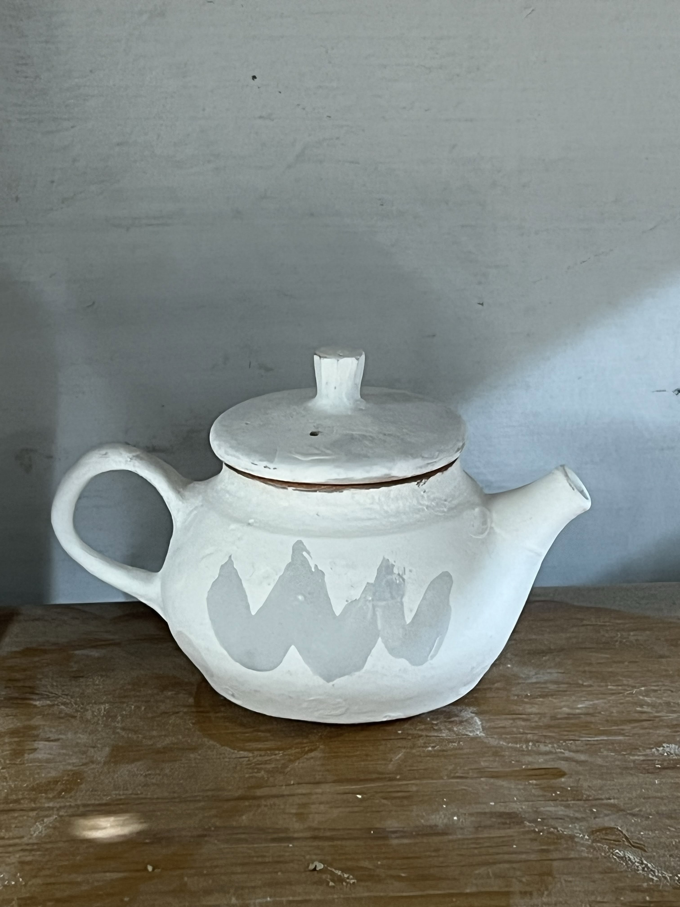
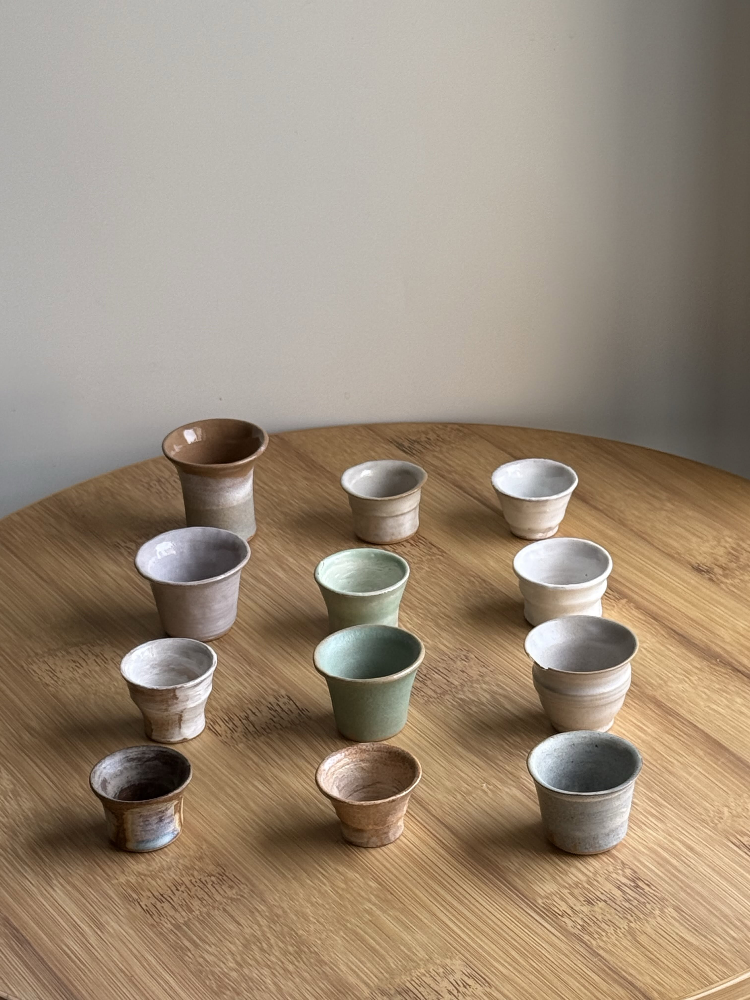
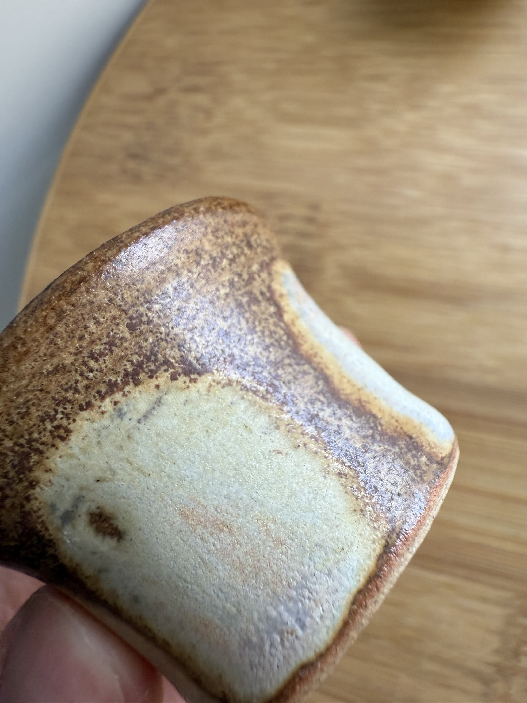
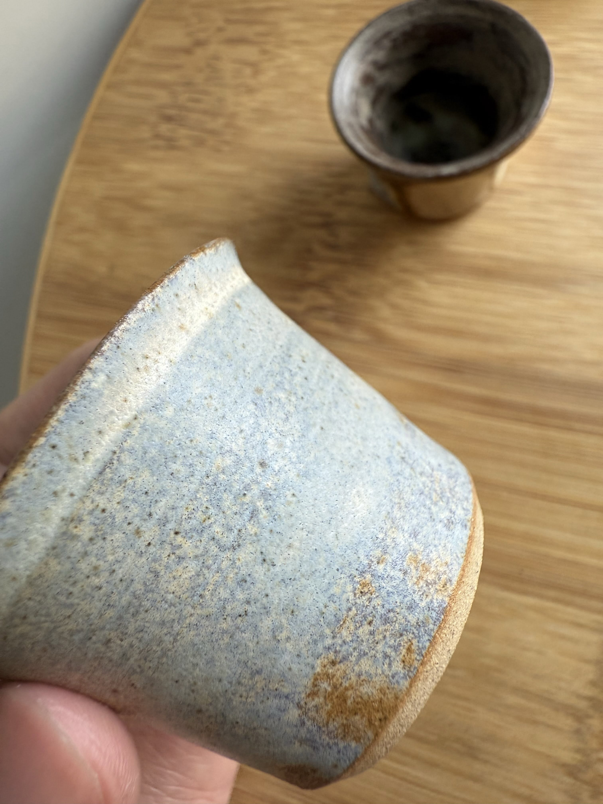
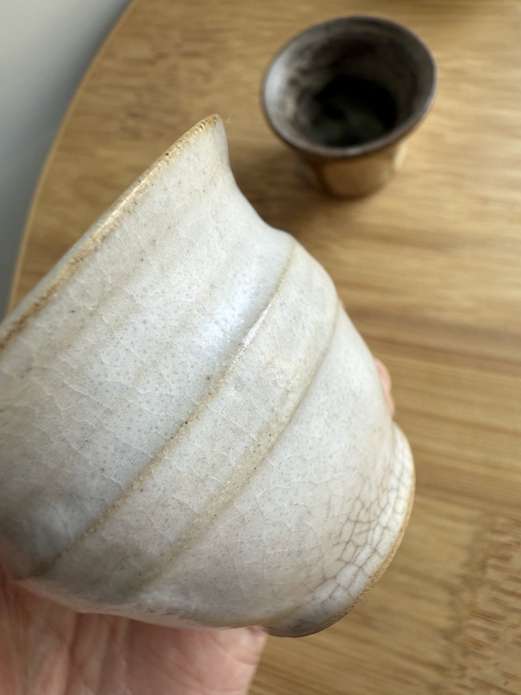

終於把我的第三把茶壺上好釉了。

土胚其實在七月底就已經完成，花了很多心血製作這把茶壺，所以想要謹慎選擇釉的搭配，好好的完成它。做了好幾組試釉的茶杯來探索方向。嘗試了不同的釉，不同的上法，不同的厚度還有跟瓷漿的搭配。

最初嘗試的方向是霧面白釉，嘗試過一輪之後發現，我使用的黃陶搭配現有的白釉跟我想的有落差，瓷土更能顯白。我的胚體已經素燒，也許下一個茶壺會使用瓷土，但我喜歡這個胚體，我想要完成它，於是就開始思考其他做法。

跟老師討論過後，知道了可以在素胚上瓷漿，讓白釉更白，接著做了一些茶杯嘗試這個做法。此外也嘗試了白色以外的釉，雖然它們不是我偏愛的顏色，但是它們都是很有質感的釉，像緞帶一樣的柔和光澤，同時帶有紋理跟結晶，摸起來也很溫潤。這些釉表現都很棒，也讓我思考能不能就用這些釉做出我會喜歡的茶壺呢？

我喜歡這個想法，每個工作室都有自己的特色，如果能結合這些特色跟自己想做的東西，做出只有在這裡能做出的作品，對我來說很有意義，也有更多連結。

最後上在茶壺的就是這兩個方向的組合，瓷漿加上白釉，與其他釉的疊釉。儘管已經做了這麼多嘗試，還是對於這個茶壺沒什麼把握，不過做陶就是這樣吧，享受過程然後 let go。停在這裡只是覺得屬於這個茶壺的時刻已經到了，更多的實驗就留給下把茶壺吧。

要成為讓人印象深刻的茶壺唷！

附上釉的近照

